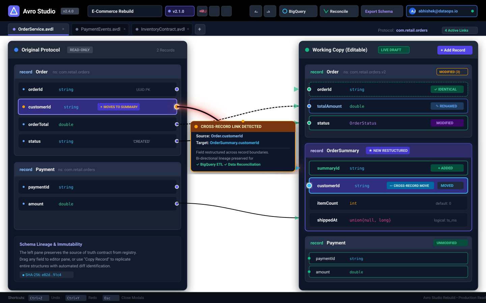

# Avro Studio

A modern, high-performance web studio for viewing, editing, diffing, and reconciling Apache Avro IDL (`.avdl`) schemas and Avro JSON schemas.

Designed for data platform engineers, analytics engineers, and backend developers who need visual schema authoring, migration tracking, BigQuery DDL/JSON generation, and automated data reconciliation.



> **Documentation & GitHub Pages**: Visit the interactive documentation site at [`docs/index.html`](docs/index.html).

---

## Key Features

- **Visual Schema Authoring & Dual-Pane Editor**: Edit records, fields, types, documentation, and annotations side-by-side with instant live updates.
- **Cross-Record Field Movement & Linking**: Move and link fields across different records (e.g. reparenting `customerId` or `status` from `Order` to `OrderSummary` or `Shipment`) with vivid glowing SVG bezier curves and automated migration lineage tracking.
- **Multi-Contract Workspaces**: Maintain multiple interrelated schema files in a single tabbed workspace session with persistent draft state.
- **Semantic Versioning & Namespaces**: Quick-bump schema versions (`+Patch`, `+Minor`, `+Major`) and maintain namespace isolation per record to avoid microservice naming collisions.
- **Bi-directional AVDL & Avro JSON Parsing/Serialization**: Full support for protocols, records, enums, fixed types, arrays, maps, and unions.
- **Intelligent Schema Diff Engine**: Identifies identical, added, deleted, renamed, moved, and modified fields between original and edited schemas.
- **BigQuery Schema Generator**: Translates Avro primitive, logical (`timestamp-millis`, `decimal`), enum, fixed, array, and nested record types into production-grade BigQuery schema definitions.
- **Tabular Data Reconciliation**: Automated data reconciliation running key-based comparisons between source and target datasets using schema linkages.
- **Schema Registry Proxy & SQLite Persistence**: Multi-workspace state persistence with WAL mode, revision snapshots, and CORS-bypassing Schema Registry proxy.
- **Unified Single-Port Production Server**: Hono server hosting REST APIs and serving client static assets from a single port (`3000`).

---

## Visual Dual-Pane Architecture & Restructuring

Avro Studio presents a dual-pane workspace designed for safe, audit-compliant schema refactoring:

1. **Left Pane ("Original Protocol")**: Represents the immutable baseline contract imported from Confluent/Karapace Schema Registry, local `.avdl`, or Avro JSON (`.avsc`).
2. **Right Pane ("Working Copy")**: An interactive draft where fields can be added, modified, reordered via drag-and-drop, or re-parented across records.
3. **SVG Connection Overlay**: Renders dynamic cubic bezier curves between matching fields. Identical fields render in green, modified/renamed fields in blue, and cross-record moved fields in high-visibility glowing neon gradients.

```
       Original Protocol (Registry)                 Working Copy (Editable Draft)
┌────────────────────────────────────────┐       ┌────────────────────────────────────────┐
│ record Order {                         │       │ record Order {                         │
│   string orderId;                      ├───────┼─► string orderId;                      │
│   string customerId;                   ├───┐   │   double totalAmount; (renamed)        │
│   double orderTotal;                   │   │   │   OrderStatus status; (modified)       │
│   string status;                       │   │   │ }                                      │
│ }                                      │   │   │                                        │
│                                        │   └───┼─► record OrderSummary {                │
│ record Payment {                       │       │     string summaryId; (+added)         │
│   string paymentId;                    │       │  ★  string customerId; (CROSS-RECORD)  │
│   double amount;                       │       │     int itemCount;                     │
│ }                                      │       │ }                                      │
└────────────────────────────────────────┘       └────────────────────────────────────────┘
```

---

## Keyboard Shortcuts

Avro Studio features comprehensive keyboard shortcuts for fast, non-disruptive editing:

| Shortcut | Action | Description |
| :--- | :--- | :--- |
| `Ctrl + Z` / `⌘ + Z` | **Undo** | Reverts the previous field mutation, type update, or reorder |
| `Ctrl + Y` / `⌘ + Y` | **Redo** | Re-applies the reverted state change |
| `Ctrl + Shift + Z` / `⌘ + Shift + Z` | **Redo (Alt)** | Alternative cross-platform redo shortcut |
| `Escape` (`Esc`) | **Close Modals** | Dismisses any active modal (BigQuery, Recon, Linkages, Previews) |

---

## Architecture Overview

```
                      ┌────────────────────────────────────────┐
                      │              Web Browser               │
                      │  (React 19 + Tailwind CSS + Lucide)    │
                      └──────────────────┬─────────────────────┘
                                         │ HTTP / REST
                                         ▼
                      ┌────────────────────────────────────────┐
                      │          Hono Server (:3000)           │
                      │                                        │
                      │  ┌──────────────┐    ┌──────────────┐  │
                      │  │ Static SPA   │    │ Workspace &  │  │
                      │  │ dist/client  │    │ Proxy APIs   │  │
                      │  └──────────────┘    └──────┬───────┘  │
                      └─────────────────────────────┼──────────┘
                                                    │
                                ┌────────────────────┴───────────────┐
                                │ SQLite Database (better-sqlite3)   │
                                │ /data/avro-editor.db (WAL mode)    │
                                └────────────────────────────────────┘
```

### Core Modules

- `src/core/parser`: AVDL and Avro JSON parsers converting schemas into normalized AST protocols.
- `src/core/serializer`: High-fidelity AVDL and Avro JSON serializers.
- `src/core/utils/schemaDiff`: Structural diff computation with renaming/move heuristics.
- `src/core/utils/bqSchemaGenerator`: Translation layer converting Avro schema trees into Google BigQuery table definitions.
- `src/core/utils/exportLinkages`: Serializer generating machine-readable migration JSON contracts.
- `src/core/utils/reconEngine`: Data reconciliation report generator with matching percentage analytics.
- `src/server`: Lightweight Hono backend, better-sqlite3 with Drizzle ORM, Schema Registry proxy routes, and static asset middleware.
- `src/client`: Modern React client with responsive dual-pane layout, contract tabs, drag-and-drop (`@dnd-kit`), and real-time SVG connection overlays.

---

## API Reference

The production Hono backend exposes clean REST endpoints:

### Workspaces API

- `GET /api/workspaces`: Lists all persisted workspaces with revision metadata.
- `GET /api/workspaces/:id`: Retrieves full workspace payload including multi-contract protocols.
- `POST /api/workspaces`: Saves or updates workspace state (`{ id, name, contracts, activeContractId, schemaVersion }`).
- `DELETE /api/workspaces/:id`: Deletes a workspace.

### Schema Registry Proxy API

- `POST /api/registry/proxy`: Proxies schema fetching and subject queries to external Confluent/Karapace Schema Registries, bypassing browser CORS restrictions.
- `GET /health`: Liveness and database readiness probe.

---

## Development Setup

### Prerequisites

- Node.js >= 20.0.0
- npm >= 10.0.0

### Installation

```bash
git clone https://github.com/example/avro-studio.git
cd avro-studio
npm install
```

### Running Locally

To run the Vite development server with hot-reloading:

```bash
npm run dev
```

### Running Tests

Run Vitest across all test suites (unit, parser, serializer, server, e2e):

```bash
npm test
```

### Building for Production

Build both the frontend SPA (`dist/client`) and compile the TypeScript server (`dist/server`):

```bash
npm run build
```

### Starting the Production Server

```bash
npm start
```

By default, the server listens on `http://localhost:3000`.

---

## Production Container (Docker)

Avro Studio includes an optimized multi-stage `Dockerfile` that packages both the frontend assets and backend server into a lean Alpine image running as a non-root `node` user.

### Build Image

```bash
docker build -t avro-studio:latest .
```

### Run Container

Mount a persistent volume to store the SQLite database:

```bash
docker run -d \
  -p 3000:3000 \
  -v avro-data:/data \
  -e PORT=3000 \
  -e AVRO_DATA_DIR=/data \
  --name avro-studio \
  avro-studio:latest
```

### Configuration & Environment Variables

| Variable | Default | Description |
| :--- | :--- | :--- |
| `NODE_ENV` | `production` | Application environment mode |
| `PORT` | `3000` | Port on which the unified server listens |
| `AVRO_DATA_DIR` | `/data` | Directory where `avro-editor.db` will be stored |
| `DATABASE_PATH` | `${AVRO_DATA_DIR}/avro-editor.db` | Explicit path override for the SQLite database file |

---

## Security Practices

- **Non-Root Execution**: Container runs strictly under the non-privileged `node` user (`UID 1000`).
- **Minimal Image Surface**: Multi-stage build with native build dependencies (`python3`, `make`, `g++`) stripped out of the final runtime stage.
- **Strict Network Isolation**: The Schema Registry proxy only forwards validated HTTP/HTTPS requests to prevent SSRF vulnerabilities.
- **Database Safety**: Prepared statements via Drizzle ORM and better-sqlite3 prevent SQL injection.
- **Data Integrity**: SQLite configured with `PRAGMA journal_mode = WAL`, `PRAGMA synchronous = NORMAL`, and `PRAGMA foreign_keys = ON`.

---

## License

Apache-2.0
